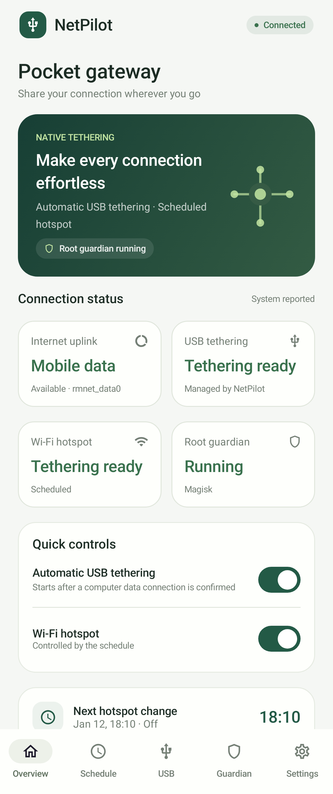
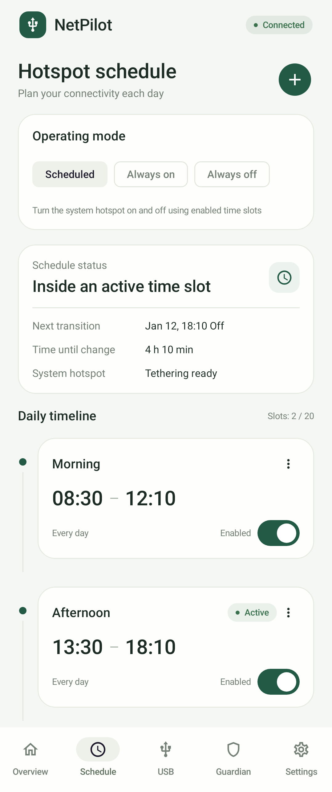
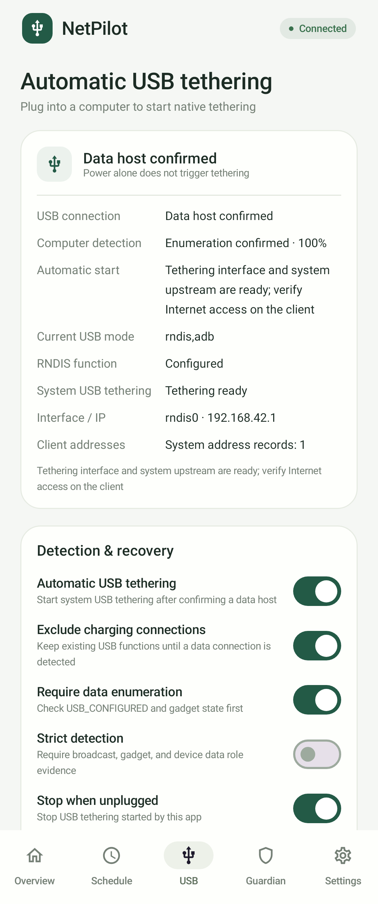

# NetPilot Pocket Gateway

[简体中文](README.md)

NetPilot turns on USB tethering when you connect your rooted Android phone to a computer. It can also turn your Wi-Fi hotspot on and off on a schedule.

[Download the release APK](https://github.com/moeneri/NetPilot/releases)

## Features

- **Automatic USB tethering.** Tethering starts after NetPilot confirms a data connection. A power-only connection leaves the current USB mode in place.
- **Hotspot scheduling.** Set multiple time slots by day of the week, or keep your hotspot on or off manually. On supported phones, NetPilot keeps its hotspot on during the scheduled window even when nobody is connected. It restores the previous idle shutdown setting when the session ends.
- **Share an available connection.** Android selects the internet connection to share. If your phone supports it, you can share Wi-Fi over USB or use USB tethering and a Wi-Fi hotspot at the same time.
- **Status and quick controls.** Check both connections in Overview. Use Guardian to pause or resume automation and view logs. Settings includes English and Chinese, dark mode, and configuration backup.

## Screenshots

| Overview | Hotspot schedule | Automatic USB tethering |
| :---: | :---: | :---: |
|  |  |  |

The screenshots show the app with example data.

## Getting started

1. Use a **rooted phone running Android 11 or newer**. Download and install the release APK from [GitHub Releases](https://github.com/moeneri/NetPilot/releases).
2. Open NetPilot, tap **Grant Root & install guardian**, and approve the request in your root manager.
3. **USB tethering.** Enable **Automatic USB tethering** on the USB tab and plug into your computer with a USB data cable. Once the app shows **Tethering ready**, check internet access on the computer.
4. **Hotspot schedule.** Open Schedule, choose **Scheduled**, and set the days and times you want. The default windows are **08:30–12:10** and **13:30–18:10** every day. Manage the hotspot name and password in your phone’s system settings.

If tethering fails to start, check whether you can turn it on in Android settings. You can also open **Run logs** in Guardian. To remove NetPilot and restore the settings it managed, use **Uninstall app completely** in Guardian.
