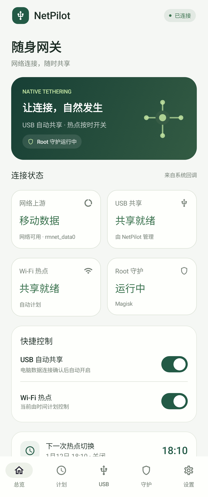
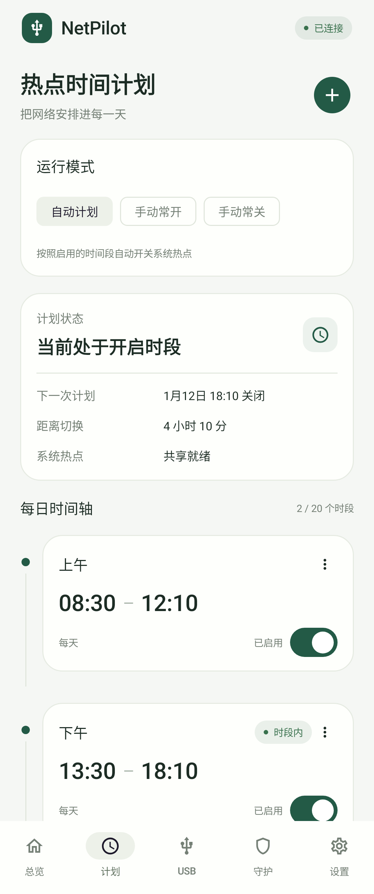
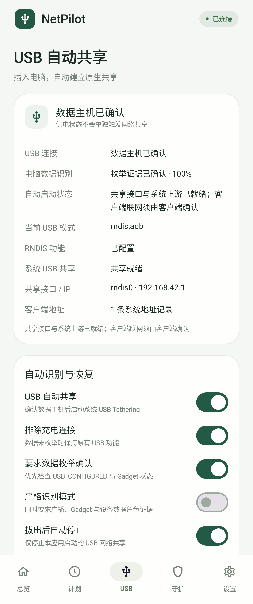

# NetPilot 随身网关

[English](README.en.md)

NetPilot 可以让已 Root 的 Android 手机在接入电脑时自动开启 USB 网络共享，也可以按你设定的时间开启和关闭 Wi-Fi 热点。

[下载正式版 APK](https://github.com/moeneri/NetPilot/releases)

## 功能

- **自动 USB 共享**。确认与电脑建立数据连接后自动开启共享。仅检测到供电时，保持当前 USB 模式。
- **定时热点**。可按星期设置多个时段，也可以让热点手动常开或常关。设备支持时，NetPilot 管理的热点在时段内即使没有设备连接也会保持开启，到点关闭并恢复系统的空闲关闭设置。
- **共享可用网络**。由 Android 选择上网来源。手机支持时，可以把接入的 Wi-Fi 通过 USB 共享给电脑，也可以同时使用 USB 共享和 Wi-Fi 热点。
- **随时查看和暂停**。在总览查看共享状态。在「守护」中暂停、恢复自动化或查看日志。「设置」支持中英文切换、深色模式和配置备份。

## 截图

| 总览 | 热点时间计划 | USB 自动共享 |
| :---: | :---: | :---: |
|  |  |  |

截图使用示例数据展示应用界面。

## 安装和使用

1. 准备一台**已 Root、运行 Android 11 或更新版本**的手机。从 [GitHub Releases](https://github.com/moeneri/NetPilot/releases) 下载并安装正式版 APK。
2. 打开 NetPilot，在首页点 **授予 Root 并安装守护**，在 Root 管理器中允许授权。
3. **USB 共享**。打开「USB → USB 自动共享」，用支持数据传输的 USB 线接入电脑。页面显示「共享就绪」后，在电脑上确认能上网。
4. **定时热点**。在「计划」选择「自动计划」，按星期设置启停时段。默认时段为每天 **08:30–12:10** 和 **13:30–18:10**。热点名称和密码在手机的系统设置中管理。

如果共享无法开启，请先在手机的系统设置中确认该功能可以手动打开。也可以到「守护 → 运行日志」查看原因。需要卸载时，可从「守护」页使用「完整卸载应用」恢复设置。
